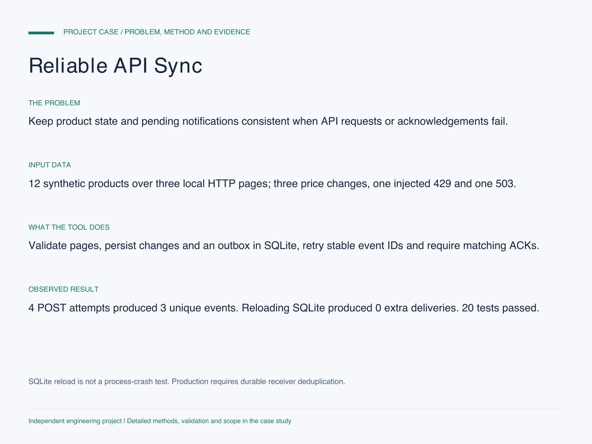

# Reliable API Sync

[中文](README.md) | **English**

A small Python integration that validates a paginated product API, persists state in SQLite and uses a transactional outbox for change notifications.

[Detailed case study: problem, data, method, evidence and limits](CASE_STUDY.md)

**Independent engineering demonstration using synthetic products and a loopback HTTP server, not a live shop or messaging account.**

## Reproduce locally

Python 3.10+, standard library only. The integration test needs permission to bind a local loopback port.

    python -m unittest -v
    python demo.py --output demo-output

The test server listens only on 127.0.0.1 and shuts down when the demo finishes. No API key is needed and no external service is contacted.

To adapt the documented product contract to an API you are authorized to use:

    python api_sync.py --base-url https://your-authorized-api.example --db state.sqlite

That command stores changes but does not send notifications. Explicit delivery requires `--send-to https://your-authorized-receiver.example/events`. A source API token may be read from an existing environment variable using `--token-env`; it is never forwarded to the event receiver. Receiver authentication must be implemented for the target system before production use.

## API contract

`GET /products` returns `items` and `next_cursor`. Subsequent requests use the cursor query parameter. Each item contains `id`, positive integer `revision`, a nonnegative decimal-string `price`, and an allowlisted `currency` (USD/GBP/CNY/AED in this demo).

    {"items":[{"id":"DEMO-01","revision":1,"price":"10.00","currency":"USD"}],"next_cursor":null}

The receiver must acknowledge a POST with `{"accepted": true, "event_id": "the-matching-id"}` and durably deduplicate the `Idempotency-Key` header. Baseline synchronization does not emit change events.

## Verified integration scenario

| Step | Observed result |
| --- | --- |
| First sync after a simulated HTTP 429 | 12 products persisted across three pages |
| Three revised prices after closing/reopening SQLite | 3 outbox events created |
| Replay of the same product revisions | 0 new events |
| Receiver processes an event but first returns HTTP 503 | Same event retried with the same idempotency key |
| Delivery totals | 4 HTTP POST attempts, 3 unique receiver events |
| SQLite state reload and delivery replay | 0 new deliveries, 0 pending events |

`sample_evidence.json` contains the actual local run evidence. Twenty automated tests cover schema/decimal validation, pagination loops and limits, revision conflicts, transactions, bounded retries, non-retryable 401 responses, bad acknowledgements and the real loopback HTTP scenario.

The database is closed and reopened in the same Python process. This is not a separate-process restart, crash or power-loss test. The receiver stays running and deduplicates only in memory. `verification.json` records the test methods, runtime and source hashes.

## Reliability and limits

- Bounded attempts/timeouts, capped backoff, explicit HTTPS except loopback, and redirects disabled.
- Fetch and validate all pages before a database transaction. Malformed or conflicting records fail the run, preserving the prior state.
- A product revision must increase when values change. Older revisions are ignored; reused conflicting revisions are rejected.
- The outbox provides **at-least-once delivery attempts**, not universal exactly-once delivery. The receiver must implement durable idempotency. The demo receiver deduplicates in memory only.
- Single sender/worker only. No distributed locking, production receiver authentication, scheduling, monitoring, full-refresh deletions, store-specific adapters or SLA is included.
- Retry-After supports delta seconds, not HTTP-date values. Response and pagination limits are intentionally bounded.
- A real deployment still needs the provider's access permission, credentials, contract, receiver setup and target-environment acceptance testing.

## Project notes

The source, contract and recorded tests document the demonstrated capability. No third-party accounts, marketplace scraping, real product feeds or external notifications are part of the demo.
